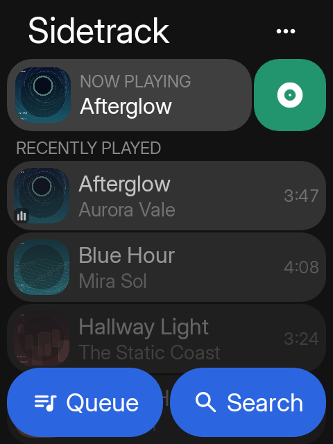
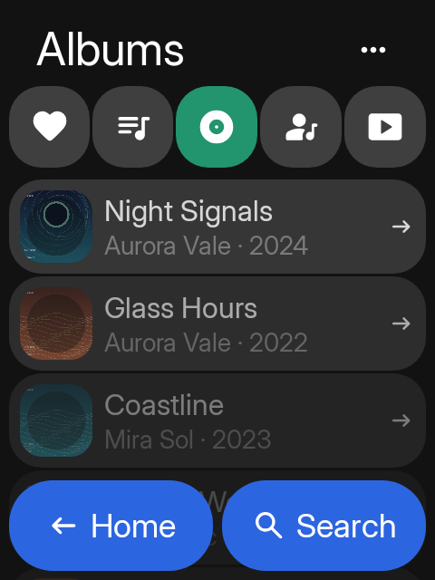
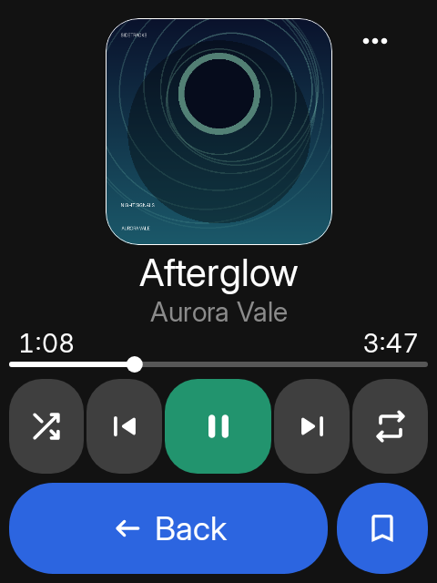
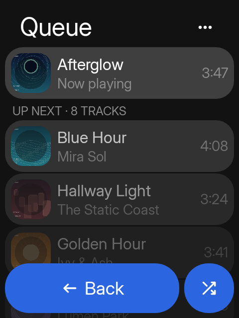
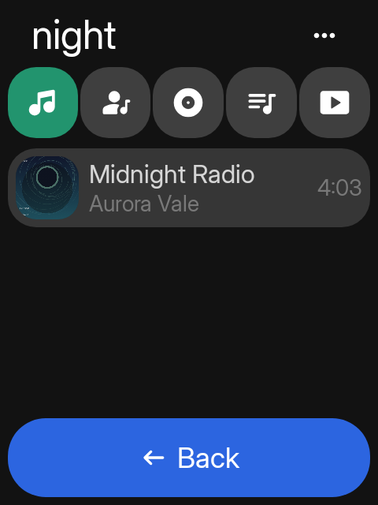
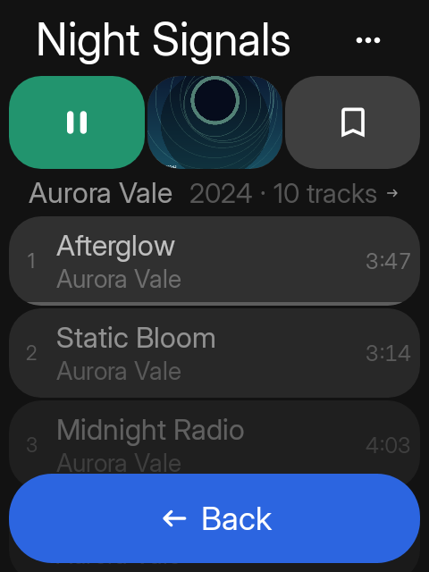
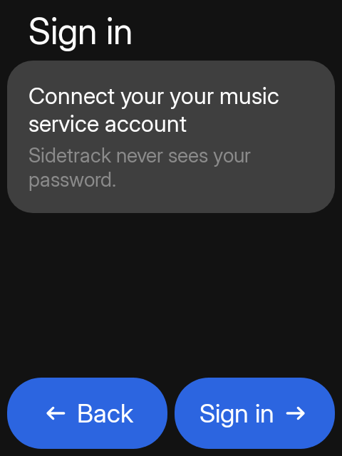
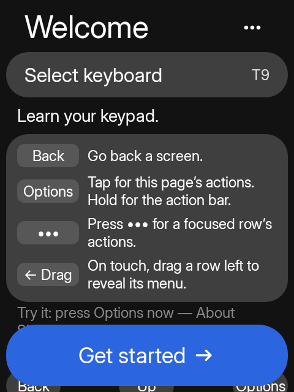
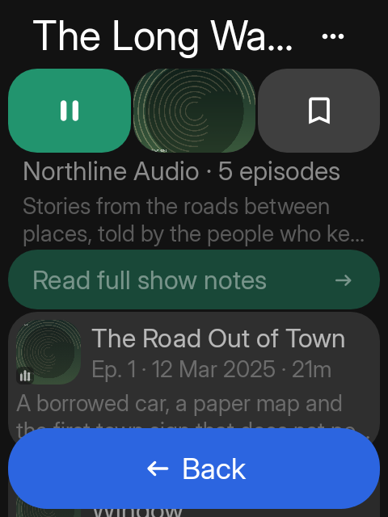

<p align="center">
  
</p>

<h1 align="center">Sidetrack</h1>

<p align="center"><strong>A music player for the Sidephone, built around its keypad.</strong></p>

<p align="center">
  <a href="https://github.com/manuel-rtsch/Sidetrack/releases/latest"></a>
  <a href="LICENSE"></a>
  
  <a href="https://www.sidephone.com/"></a>
</p>

Sidetrack is a music player for Android 12 and later, built around the keypad of the [Sidephone SP-01](https://www.sidephone.com/).

It plays from Spotify, Plex, Jellyfin, any Subsonic-compatible server such as Navidrome, or the music already on the phone. Every action works from the keypad, and touch works equally well. If [Sidekit](https://github.com/HarlenPostill/Sidekit), a launcher for the SP-01, is installed, Sidetrack follows its theme, accent, input mode and key mappings.

> Sidetrack is an independent project, not made by or affiliated with Sidephone, Spotify, Plex, Jellyfin or any other service it connects to.

## Screenshots

| Home | Library | Now Playing |
| --- | --- | --- |
|  |  |  |

| Queue | Search | Album |
| --- | --- | --- |
|  |  |  |

| Sign in | Welcome | Podcast |
| --- | --- | --- |
|  |  |  |

## Install

All three routes give you the same signed app.

**1. App pack (SP-01).** An app pack is a source of apps for the SP-01's Library. Add the Sidetrack pack, and Sidetrack installs from the Library with no "unknown sources" prompt and updates silently.

<p align="center">
  
</p>

Open `Library → Settings → App Packs → +` and scan the code, or enter `https://manuel-rtsch.github.io/sidetrack-pack/fdroid/repo` by hand. The phone shows a signing fingerprint. It should read `07E18BC4…FAE17488`, and the full value is on the [pack's install page](https://manuel-rtsch.github.io/sidetrack-pack/).

**2. Obtainium.** [Obtainium](https://github.com/ImranR98/Obtainium/releases/latest) watches GitHub releases. Point it at this repository to get update notifications on any Android 12+ phone.

**3. APK.** Download the signed APK from the [latest release](https://github.com/manuel-rtsch/Sidetrack/releases/latest).

## Supported services

Sidetrack remembers your service until you sign out. Spotify and Plex sign in through the browser; the server entries take a server address, a username and a password; **Local library** asks for access to the phone's music library. Navidrome, Nextcloud Music and Subsonic are listed separately because that is the server you run, and any other Subsonic or OpenSubsonic server works through the **Subsonic** entry. Each entry keeps its own credentials, queue and history.

| | Spotify | Subsonic family | Jellyfin | Plex | Local library |
| --- | --- | --- | --- | --- | --- |
| Radio | Song radio from any seed | Similar songs | Instant Mix | — | — |
| Podcasts | ✅ | ❌ | ❌ | ❌ | ❌ |
| Follow artists | ✅ | ❌ | ✅ | ❌ | ❌ |
| Create playlists | ❌ | ✅ | ✅ | ❌ | ✅ |
| Edit playlists | ✅ | ✅ | ✅ | ✅ | ✅ (Sidetrack's own files) |
| Loudness normalisation | ✅ | ✅ | ❌ | ❌ | ❌ |
| Gapless playback | ✅ | ❌ | ❌ | ❌ | ❌ |
| Quality selection | ✅ | ✅ | ✅ | ❌ | ❌ |

Spotify needs a Premium account for playback. Jellyfin needs a 12.x server with a music library. Plex needs a claimed Plex Media Server.

## What you can do

- Browse and search liked tracks, playlists, albums and artists.
- Control playback with the phone's own keys, the lock screen or the notification.
- Queue tracks, reorder them and see what played before.
- Play one track from an album without losing your queue. If a tap replaces the queue, `Undo` restores it for 8 seconds.
- Start a song radio from whatever is playing, except on Plex.
- Like tracks, save albums, and follow artists on Spotify and Jellyfin.
- Create, edit, rename and delete playlists where the service allows it.
- Follow Spotify podcasts with show notes and per-episode resume.
- Set a sleep timer.

## Limits

Spotify library and search need the native bridge, a bundled librespot client. Without it, Spotify falls back to the public Web API, which rate-limits the shared client ID. Release APKs include the bridge, and your own build needs `-PsidetrackNative=true`. Jellyfin servers older than 12.0 are refused at sign-in, because they accept the login and then fail every read.

## Getting started

1. Install Sidetrack. [Sidekit](https://github.com/HarlenPostill/Sidekit/releases/latest) is optional.
2. Choose a service. Plex finds your server from the account.
3. To try the app without a server, choose **Navidrome** and submit the blank sign-in form. It signs in to the shared demo at [demo.navidrome.org](https://demo.navidrome.org) (`demo` / `demo`).
4. Follow the **Welcome** screen to set up your keyboard and keypad.

## Building from source

You need JDK 21 and the Android SDK. Spotify playback through librespot also needs the Android NDK and a Rust toolchain.

```sh
./gradlew :app:assembleProfile -PsidetrackNative=true
```

Release builds refuse to package without the bridge.

## Licence

MIT. Sidetrack also links librespot. Its licence and notice ship with the native build.

Exception: `provider-spotify/src/main/java/io/github/manuelrtsch/sidetrack/auth/` was written with the GPLv3 Sidespot auth path as a reference and is therefore a derivative of it. That package is pending a clean-room rewrite or a GPLv3 notice.
